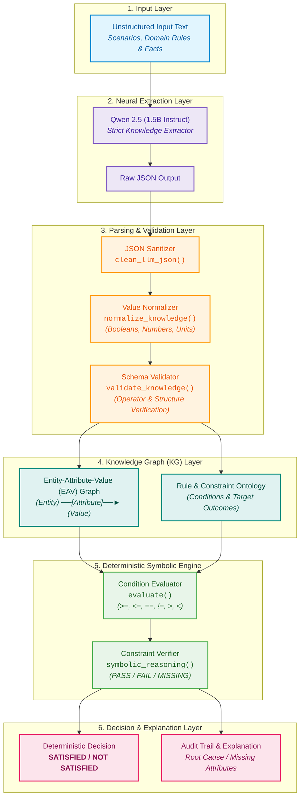

# Neuro-Symbolic LLM

An end-to-end **Neuro-Symbolic AI Pipeline** that fuses the natural-language understanding of Large Language Models (LLMs) with the precision, deterministic verification, and 100% auditability of a **Symbolic Reasoning Engine**.

---

## 🏛️ System Architecture



---

## 🔍 How It Works

The architecture splits problem-solving into distinct phases:

1. **Neural Phase (Knowledge Extraction)**:
   - Ingests natural-language text describing a problem, policy, or scenario.
   - **`Qwen/Qwen2.5-1.5B-Instruct`** parses unstructured text into a strict, structured JSON schema containing entities, factual values, logical conditions, and conclusions without making assumptions.

2. **Parsing, Normalization & Validation**:
   - Cleans the LLM output (`clean_llm_json`) and normalizes data types (`normalize_knowledge`), converting strings to booleans, floats, and integers.
   - Enforces schema validity and supported comparison operators (`validate_knowledge`).

3. **Knowledge Graph (KG) Representation**:
   - Structures factual entities and attributes into an **Entity-Attribute-Value (EAV) Knowledge Graph** `(Entity) ──[Attribute]──► (Value)`.
   - Organizes rules and decision criteria into a formal constraint ontology.

4. **Symbolic Phase (Deterministic Reasoning)**:
   - Evaluates factual values from the Knowledge Graph against conditional rules using a deterministic rule engine (`symbolic_reasoning` & `evaluate`).
   - Checks conditions with standard relational operators (`>=`, `<=`, `==`, `!=`, `>`, `<`).
   - Generates a granular condition status (`PASS`, `FAIL`, or `MISSING`).

5. **Explainable Decision & Audit Trail**:
   - Produces a verifiable conclusion.
   - Explains the exact reasoning behind approval, rejection, or missing data.

---

## 📋 Structured JSON Schema

The LLM extracts knowledge into the following standardized structure:

```json
{
  "facts": [
    {
      "entity": "Arun",
      "attribute": "credit_score",
      "value": 750
    },
    {
      "entity": "Arun",
      "attribute": "monthly_income",
      "value": 60000
    },
    {
      "entity": "Arun",
      "attribute": "existing_loan",
      "value": false
    }
  ],
  "rules": [
    {
      "conditions": [
        {
          "attribute": "credit_score",
          "operator": ">=",
          "value": 700
        },
        {
          "attribute": "monthly_income",
          "operator": ">=",
          "value": 50000
        },
        {
          "attribute": "existing_loan",
          "operator": "==",
          "value": false
        }
      ],
      "conclusion": {
        "attribute": "eligible",
        "value": true
      }
    }
  ]
}
```

---

## 💡 Example Execution

### Input Text
```text
A customer can receive an instant loan approval if the customer
has a credit score of at least 700, has a monthly income of at least
50000, and has no existing loan.

Arun has a credit score of 750.
Arun has a monthly income of 60000.
Arun has no existing loan.
```

### Execution Output
```text
===========================================================================
       NEURO-SYMBOLIC LLM
       LOGIC-CONSTRAINED REASONING
===========================================================================

1. NEURAL KNOWLEDGE EXTRACTION
FACTS:
  Arun → credit_score = 750
  Arun → monthly_income = 60000
  Arun → existing_loan = False

RULES:
  Rule 1:
    credit_score >= 700
    monthly_income >= 50000
    existing_loan == False
    → eligible = True

---------------------------------------------------------------------------
2. SYMBOLIC REASONING
Rule 1:
  ✓ credit_score >= 700 (actual = 750)
  ✓ monthly_income >= 50000 (actual = 60000)
  ✓ existing_loan == False (actual = False)
  Rule → SATISFIED

---------------------------------------------------------------------------
3. LOGIC-CONSTRAINT VERIFICATION
✓ All logical constraints satisfied.

---------------------------------------------------------------------------
4. FINAL DECISION
eligible = True

---------------------------------------------------------------------------
5. EXPLAINABLE REASONING
All logical constraints were satisfied, therefore the conclusion was derived by the symbolic engine.
===========================================================================
```

---

## 🚀 Key Advantages

| Feature | Standard LLM | Neuro-Symbolic LLM |
| :--- | :--- | :--- |
| **Hallucination Risk** | High on complex logic / numbers | **Zero** in symbolic execution |
| **Auditability** | Black-box probabilistic output | **100% Traceable** (condition-level logs) |
| **Mathematical Accuracy** | Prone to arithmetic/boundary errors | **Exact** deterministic evaluation |
| **Missing Information** | May guess or fabricate | Detects and flags **`MISSING`** facts |

---

## 📦 Requirements & Installation

```bash
pip install torch transformers accelerate sentencepiece
```

- **Model Used**: [`Qwen/Qwen2.5-1.5B-Instruct`](https://huggingface.co/Qwen/Qwen2.5-1.5B-Instruct)

---

## 💻 Usage

Run the Jupyter Notebook:
```bash
jupyter notebook neuro_sym.ipynb
```
